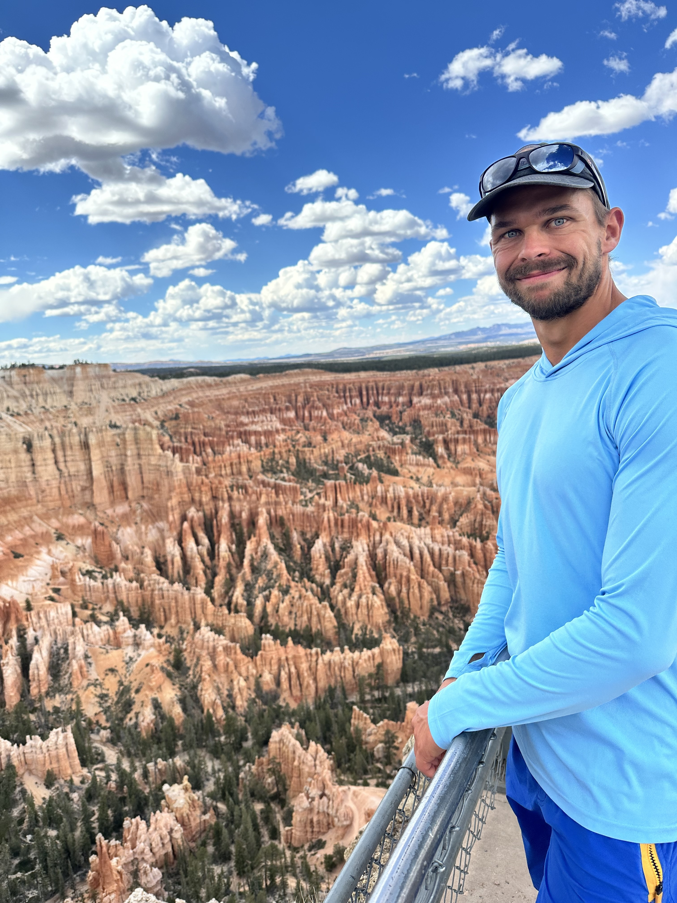

::: {.about-grid}

::: {.about-photo}
{.portrait-image}
:::

::: {.about-copy}
I am an evolutionary biologist interested in how bioactive peptides, including neuropeptides, hormones, and toxins, evolve and shape interactions between organisms.

Recently, my work has focused on how peptides mediate interactions such as venom use, parasitism, host–pathogen interactions, symbiosis, and sexual interactions, with a particular emphasis on molecular mimicry. I combine fieldwork, comparative genomics, computational biology, and physiological testing.

I am currently a Marie Skłodowska-Curie postdoctoral fellow at the University of Oslo, where I study the origin and loss of venom in marine snails.

My broader aim is to understand how evolutionary processes generate molecular innovations and how these innovations influence ecological interactions.
:::

:::

## Research approach

I enjoy research that connects organismal biology and natural history with molecular and genomic approaches. I am particularly interested in questions that can be addressed by combining broad evolutionary comparisons with targeted functional experiments.

## Experience

**2025 – 2028 · Marie Skłodowska-Curie Postdoctoral Fellow**, University of Oslo, Norway
*Deciphering evolutionary innovations: Comparative genomics of the origin and loss of venom in marine snails.*

**2023 – 2025 · International Postdoctoral Fellow** (Independent Research Fund Denmark), University of Utah, USA
*Altering prey behaviour: Uncovering the role of oxytocin/vasopressin-like toxins in cone snails.*

**2022 – 2023 · Postdoctoral researcher**, Department of Biochemistry, University of Utah, USA
Supervisor: Helena Safavi-Hemami.

**2021 – 2022 · Postdoctoral researcher**, Department of Biomedical Sciences, University of Copenhagen, Denmark
Supervisor: Helena Safavi-Hemami.

## Education

**2017 – 2021 · PhD in Evolutionary Genomics**, Department of Biology, University of Copenhagen, Denmark
Supervisor: Cornelis J. P. Grimmelikhuijzen. Thesis: *Peptidergic signaling in Placozoa and Cnidaria.*

**2014 – 2016 · MSc in Biomedicine**, University of Southern Denmark

**2012 – 2014 · BSc in Biomedicine**, University of Southern Denmark

**2009 – 2012 · BSc in Mathematics and Physics**, University of Southern Denmark

## Funding

- **Marie Skłodowska-Curie Postdoctoral Fellowship** (2025–2027)
- **Independent Research Fund Denmark, International Postdoc Fellowship** (2023–2025)
- **DMRC seed grant** (2025)

## Selected invited and international talks

- **2026** · Venoms to Drugs, Australia. *From neuropeptides to toxins* 
- **2026** · MSI Seminar, Philippines. *Genomics of venom innovation in cone snails*
- **2026** · NRM Evolutionary Genomics Seminar, Sweden. *Origin of toxins in venomous cone snails*
- **2024** · Conference of European Comparative Endocrinology, Italy. *Harnessing toxins to elucidate neuropeptide evolution and function* 
- **2024** · Gordon Research Conference on Venom Evolution, Function, and Biomedical Application, USA. *Prey shifts drive venom evolution in cone snails*
- **2024** · European Venom Network seminar (online). *Prey shifts drive venom evolution in cone snails*
- **2023** · Venoms to Drugs, Australia. *Deciphering peptidergic signalling and doppelgänger toxins*
- **2022** · Gordon Research Conference on Venom Evolution, Function, and Biomedical Application. *Discovery of novel bilaterian signalling peptides using cone snail toxins*
- **2019** · International Congress of Comparative Physiology and Biochemistry, Canada. *Comparative study of the neuropeptide complements of Cnidaria* 

## Curriculum vitae

[Download CV (PDF)](files/Thomas-Lund-Koch-CV.pdf)
