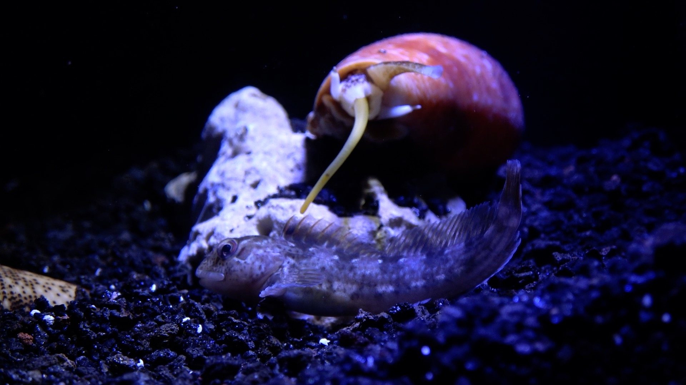
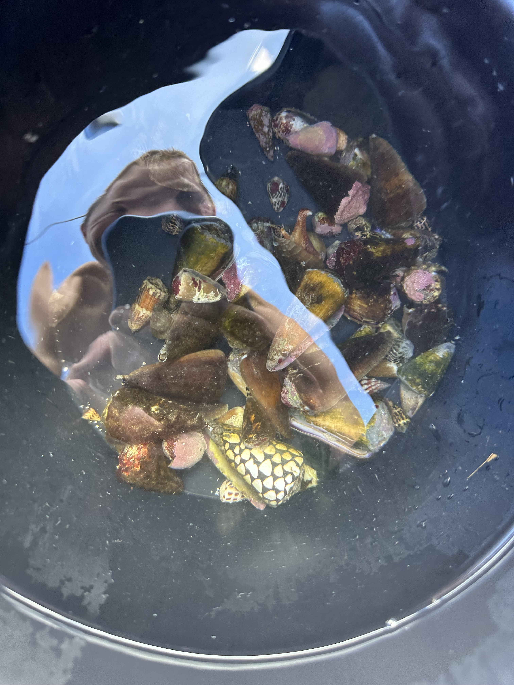
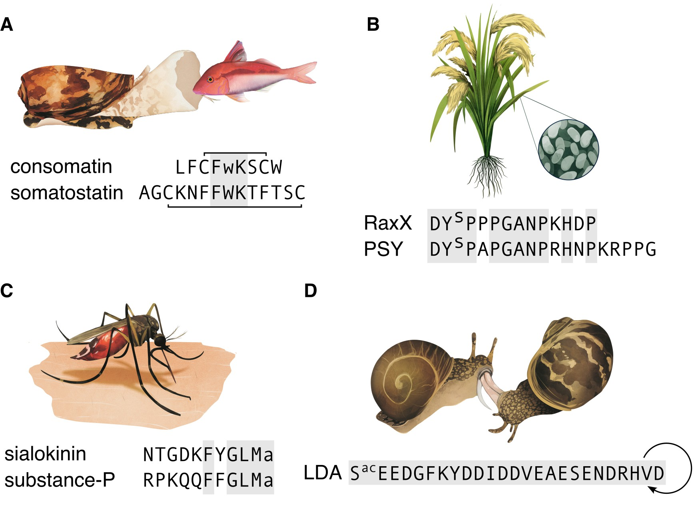
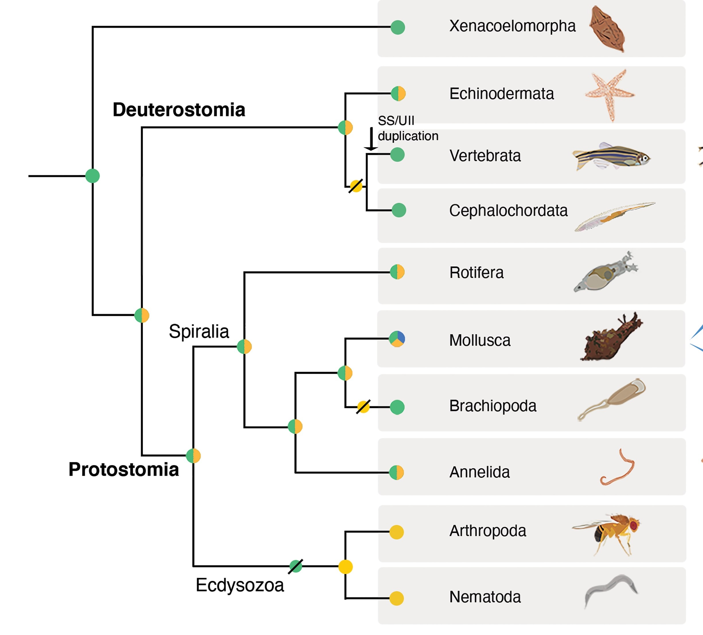

::: {.hero-grid}

::: {.hero-copy}

DR. THOMAS LUND KOCH · MSCA POSTDOCTORAL RESEARCHER · CENTRE FOR ECOLOGICAL AND EVOLUTIONARY SYNTHESIS, UNIVERSITY OF OSOLO

## How venoms, mimics, and peptide signals evolve.

I study how organisms evolve bioactive molecules, using comparative genomics and peptide biochemistry to trace how toxins, hormones, and mimics arise and diversify. My work spans cone snail venoms, neuropeptide evolution, and the molecular strategies that parasites use to manipulate their hosts.

<a class="button button-primary" href="research.html">View research</a>
<a class="button button-primary" href="about.html">About me</a>

:::

::: {.hero-image}
{.hero-photo}

<em>Conus bullatus</em>. Photo: Dylan Taylor.

:::

:::

## Research themes

VENOM &amp; EVOLUTION

<h3>Evolution of venom systems</h3>

How do animals repeatedly evolve molecular weapons?

<a href="projects/venom-evolution.html" class="card-link">Read more →</a>

HOST MANIPULATION

<h3>Molecular mimicry</h3>

How do parasites, pathogens, and other organisms exploit host signaling pathways through molecular doppelgängers?

<a href="projects/molecular-mimicry.html" class="card-link">Read more →</a>

PEPTIDE BIOLOGY

<h3>Evolution of peptide signaling</h3>

How do peptide hormones and neuropeptides diversify, acquire new functions, and shape organismal interactions?

<a href="projects/peptide-signaling.html" class="card-link">Read more →</a>

## Selected publications

<ul class="pub-list">
<li>
 <strong>Thomas L Koch</strong>, Samuel D Robinson, and Helena Safavi-Hemami.
(2025)
<a href=" https://doi.org/10.1016/j.tibs.2025.06.011" class="pub-title">Molecular mimicry: ecology, evolution, and applications of doppelgänger peptides.</a>
<em class="pub-journal">Trends in Biochemical Sciences</em>
</li>
<li>
<strong>Thomas L Koch</strong>, Giada Ferrari, Sunita B Sumanam, Maren Watkins, Kevin Chase, Ave Tooming-Klunderud, Arturo O Lluisma, Angel Yanagihara, Neil D Young, Baldomero M Olivera, Eivind A B Undheim, and Helena Safavi-Hemami.
(2026)
<a href="https://doi.org/10.1093/molbev/msag206" class="pub-title">From neuropeptides to toxins: illuminating the origins of venom complexity in cone snails.</a>
<em class="pub-journal">Molecular Biology and Evolution</em>
</li>
<li>
<strong>Thomas L Koch</strong>, Ho Yan Yeung, Iris Bea L. Ramiro, Joshua P. Torres, Alina Anhnhi Vo, Seph Palomino, Ebbe Engholm, Samuel D. Robinson, Lachlan D. Rash, Zildjian G. Acyatan, Nicholas C. Schumann, Kasper B. Pedersen, Knud J. Jensen, Katrine T. Schjoldager, Amol Patwardhan, Neil D. Young, Michael J. Robertson, and Helena Safavi-Hemami.
(2026)
<a href="https://www.cell.com/current-biology/abstract/S0960-9822(26)00885-7" class="pub-title">Mimics of the chordate gut-brain hormone neurotensin in parasitic intestinal hookworms.</a>
<em class="pub-journal">Current Biology</em>
</li>
</ul>

<a href="publications.html" class="text-link">Full publication list →</a>

## Recent

<ul class="news-list">
<li>Dec 2026 Teaching workshop on genomic annotation at University of Oslo.</li>
<li>Oct 2026 Talk at Venoms2Drugs conference at K'gari, Australia .</li>
<li>Jun 2026 Podcast interview at 'Mit store spørgsmal'.</li>
</ul>

::: {.closing-note}
**Open to collaboration.**

I'm interested in hearing from students, postdocs, and researchers working on venom biology, peptide evolution, and host-parasite interactions.

<a href="contact.html" class="text-link">Get in touch →</a>
:::

<footer class="site-footer">

Dr. Thomas Lund Koch · Center for Ecological and Evolutionary Synthesis, University of Oslo

<a href="mailto:t.l.koch@ibv.uio.no">Email</a>
<a href="https://scholar.google.com/https://scholar.google.com/citations?user=TzP53CcAAAAJ&hl=en">Google Scholar</a>
<a href="https://orcid.org/0000-0002-8489-0375">ORCID</a>
<a href="https://github.com/Thomaslundkoch">GitHub</a>

Last updated November 2026

</footer>
