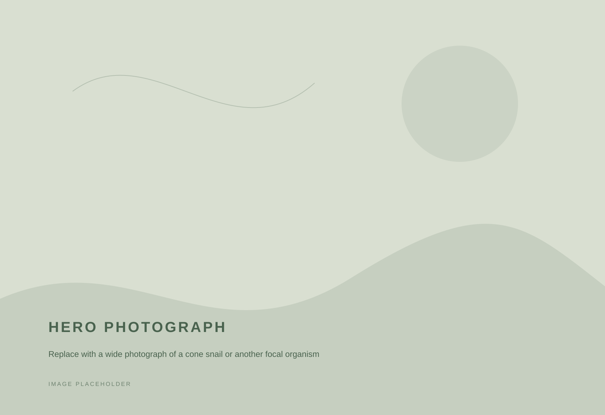
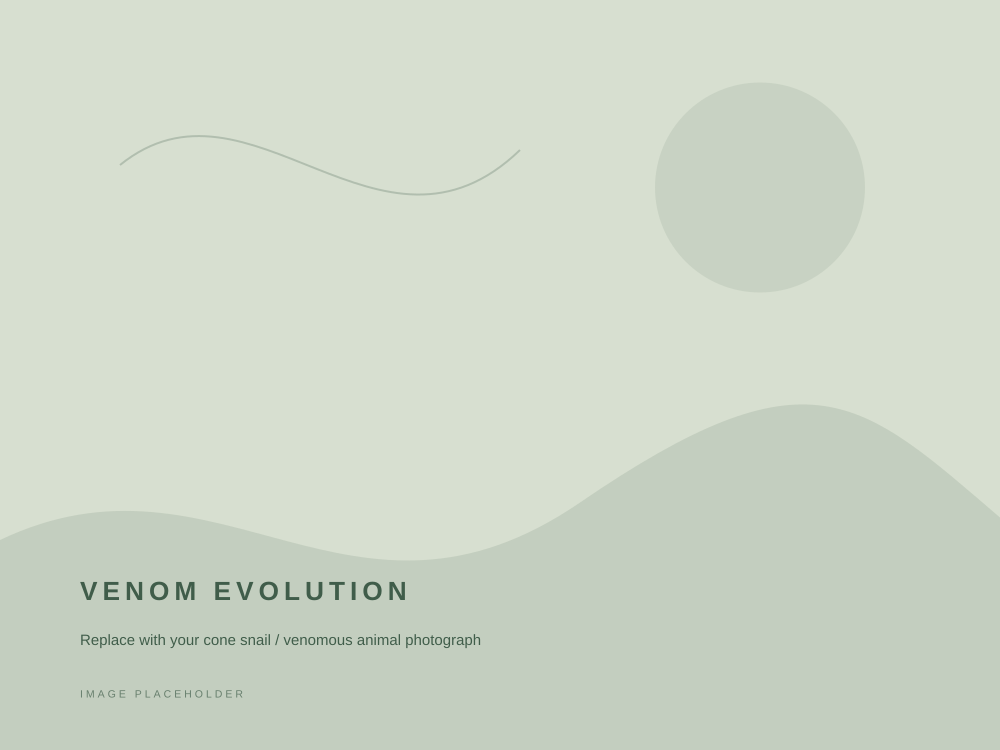
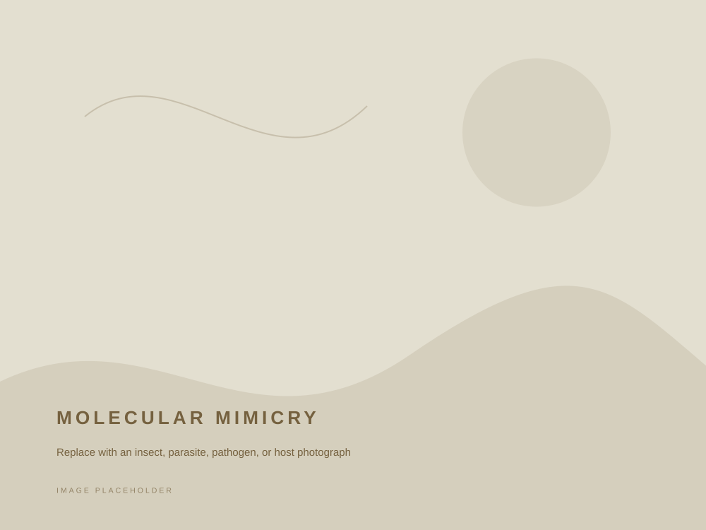
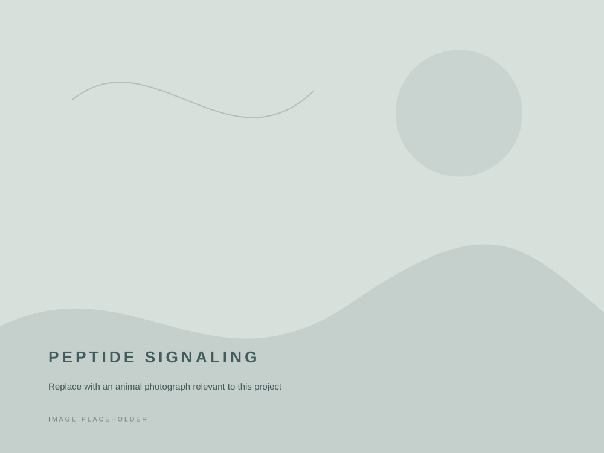

::: {.hero-grid}

::: {.hero-copy}

EVOLUTIONARY BIOLOGY · MOLECULAR ECOLOGY

# Understanding the evolution of biological interactions.

I study how organisms evolve bioactive molecules, manipulate biological systems, and develop new molecular strategies through evolution.

<a class="button button-primary" href="research.html">Explore the research</a>
<a class="text-link" href="about.html">About me ↗</a>

From genes and molecules to organisms and ecological interactions.

:::

::: {.hero-image}
{.hero-photo}

A natural-history perspective on molecular evolution

:::

:::

::: {.intro-band}

RESEARCH INTERESTS

How do molecular systems evolve, diversify, and become tools in the interactions between organisms?

:::

## Research themes

{.card-image}

01 / VENOM & EVOLUTION

<h3>Evolution of venom systems</h3>

How do animals repeatedly evolve molecular weapons, and why are particular protein scaffolds recruited into venom?

<a href="projects/venom-evolution.html" class="card-link">Explore this research ↗</a>

{.card-image}

02 / HOST MANIPULATION

<h3>Molecular mimicry</h3>

How do parasites, pathogens, and other organisms exploit host signaling pathways through molecular imitation?

<a href="projects/molecular-mimicry.html" class="card-link">Explore this research ↗</a>

{.card-image}

03 / PEPTIDE BIOLOGY

<h3>Evolution of peptide signaling</h3>

How do peptide hormones and neuropeptides diversify, acquire new functions, and shape organismal interactions?

<a href="projects/peptide-signaling.html" class="card-link">Explore this research ↗</a>

## Approaches

Comparative genomics
Evolutionary biology
Peptide biochemistry
Functional assays
Field-based natural history

::: {.closing-note}
**Interested in the research?**

I welcome conversations about collaborations, research opportunities, and the evolution of bioactive molecules.

<a href="contact.html" class="text-link">Get in touch ↗</a>
:::
