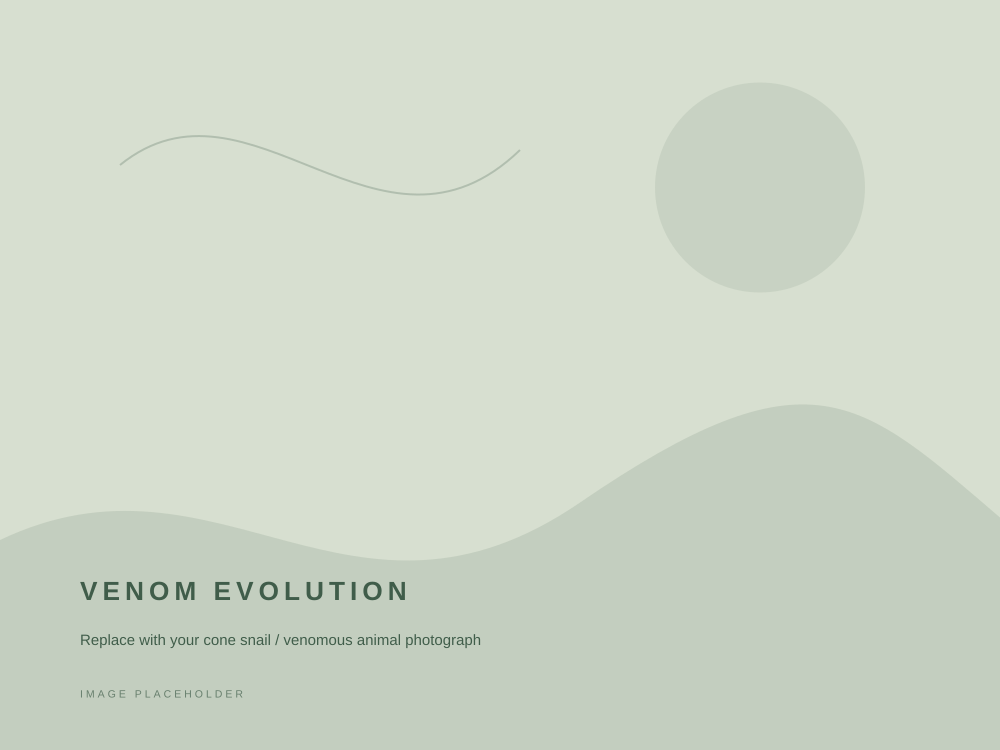
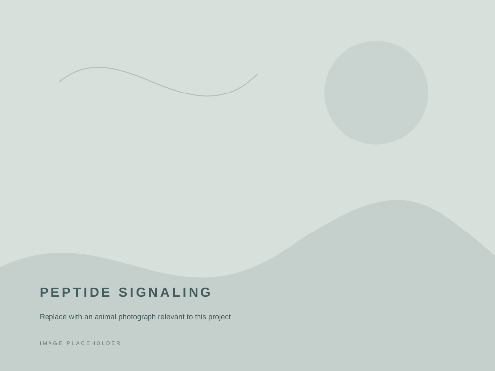

These project pages provide an overview of the questions, systems, and approaches that motivate my research. They will develop as projects progress and new results become available.

{.project-thumb}

VENOM EVOLUTION

<h3><a href="projects/venom-evolution.qmd">Repeated evolution of animal venom systems</a></h3>

Investigating the evolutionary origins of venom components and the repeated recruitment of protein scaffolds into animal venoms.

{.project-thumb}

MOLECULAR MIMICRY

<h3><a href="projects/molecular-mimicry.qmd">Molecular mimicry in biological interactions</a></h3>

Exploring how parasites and pathogens evolve peptide mimics that manipulate host signaling pathways.

{.project-thumb}

PEPTIDE EVOLUTION

<h3><a href="projects/peptide-signaling.qmd">The evolution of peptide signaling systems</a></h3>

Reconstructing the evolutionary history of peptide-encoding genes and investigating the functional diversification of signaling molecules.

