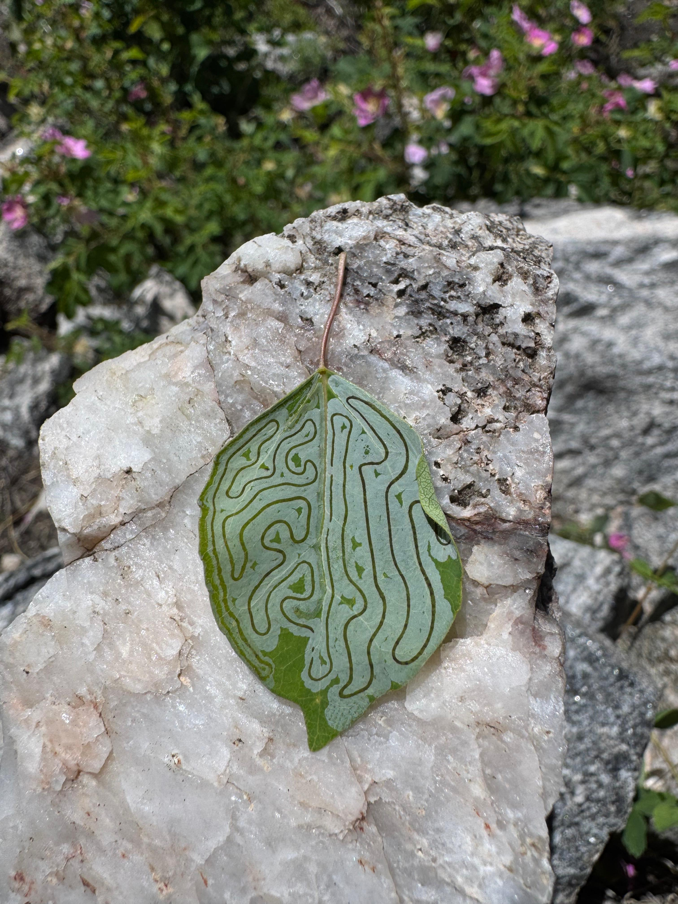

{.project-hero}

Organisms do not interact only through behavior and ecology. They also interact through molecules. Venomous animals, parasites, and pathogens can produce molecules that resemble target signaling molecules, allowing them to manipulate the target's physiology and development.

I am interested in the evolution of these molecular strategies, particularly the mimicry of peptide hormones and other signaling molecules.

## Research directions

- Identify candidate peptide mimics in interacting organisms.
- Investigate their evolutionary origins and patterns of diversification.
- Test whether candidate mimics activate host receptors or signaling pathways.

::: {.project-callout}
**Methods**

Comparative genomics · Secretome analysis · Peptide synthesis · Receptor pharmacology · Functional signaling assays
:::
